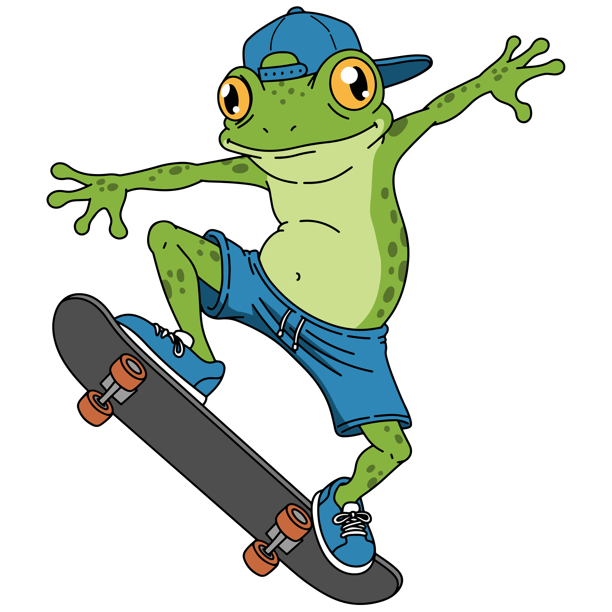

# Froggy Afterglow

<p align="center">
  
</p>

<p align="center">
  <strong>A warm sunset in a freezing world.</strong><br>
  A physics-driven 2D snowboarding game built in Unity.
</p>

<p align="center">
  
  
  
</p>

> **Froggy Afterglow** is a fast, playful downhill run where you guide Froggy across snowy slopes, build speed, launch into the air, and land cleanly enough to reach the finish line.

## The Run

Every run is a balance between control and momentum. Lean into the slopes, use the terrain to launch, and keep the frog moving through the course without crashing into the floor. Stylish flips are not just for show: every complete flip adds to the score.

### What makes it fun

- **Physics-first movement** powered by Unity's 2D Rigidbody and surface effector systems.
- **Momentum management** with normal travel speed and a temporary boost.
- **Trick scoring** with `+100` points for each complete flip.
- **Reactive snow** with a trail while the board is touching the ground.
- **Clear win and crash states** with particles and automatic scene reloads.
- **Froggy, the colorful snowboarding hero** set against a playful winter course.

## Controls

| Action | Keyboard | Gamepad |
| --- | --- | --- |
| Lean / rotate left | `A` or `Left Arrow` | Left stick left |
| Lean / rotate right | `D` or `Right Arrow` | Left stick right |
| Boost downhill | `W` or `Up Arrow` | Left stick up |
| Return to normal speed | Release the boost input | Return the stick to neutral |

### Scoring

| Moment | Result |
| --- | --- |
| Complete one full rotation | `+100` points |
| Touch the finish line | Win particles play, then the scene reloads |
| Hit the floor / crash surface | Controls are disabled, crash particles play, then the scene reloads |

## Visuals

### Hero artwork

<p align="center">
  
</p>

### Gameplay screenshots


<!--
<p align="center">
  
  
</p>
-->

## Gameplay Video


<!-- **Trailer:** [Watch the Froggy Afterglow gameplay video](docs/media/froggy-afterglow-trailer.mp4) -->

Suggested 30-second edit:

1. Start with the frog dropping onto the first slope.
2. Show a boost into a jump and one clean flip.
3. Cut to the score increasing by `100`.
4. End on the finish-line particles.

## Built With

- **Unity 6** `6000.3.24f1`
- **C#** gameplay scripts
- **Unity Input System** for keyboard and gamepad input
- **Unity 2D physics** with `Rigidbody2D` and `SurfaceEffector2D`
- **Unity Particle System** for snow trails, crashes, and finishing effects
- **TextMesh Pro** for the score display
- **Universal Render Pipeline 2D** project setup

## Run the Project

### Requirements

- Unity `6000.3.24f1` or a compatible Unity 6 installation
- A desktop keyboard, or a compatible gamepad

### Open in Unity

1. Clone or download this repository.
2. Open the project folder in Unity Hub.
3. Use the Unity version shown above when prompted.
4. Open `Assets/Scenes/SampleScene.unity`.
5. Press **Play** in the Unity Editor.

### Build a standalone version

1. Open **File > Build Profiles**.
2. Choose the target platform.
3. Add `Assets/Scenes/SampleScene.unity` to the scene list.
4. Build and run.

## Project Structure

```text
Assets/
├── Scenes/       The playable Unity scene
├── scripts/      Player movement, scoring, snow trail, crash, and finish logic
├── sprites/      Frog, snow terrain, platforms, hazards, and environment art
└── Settings/     Input System actions and 2D scene settings
```

The main gameplay responsibilities are kept in small scripts:

- `playerController.cs` handles rotation, boost speed, flip detection, and score rewards.
- `ScoreManager.cs` updates the on-screen score.
- `SnowTrail.cs` starts and stops the snow effect on ground contact.
- `crashDetector.cs` disables control and reloads after a crash.
- `finishLine.cs` plays the win effect and reloads after reaching the goal.

## Design Goals

Froggy Afterglow was built around a simple question: **can a small amount of input make a downhill run feel expressive?** The game keeps the controls compact so the challenge comes from timing, momentum, rotation, and recovery rather than a long list of buttons.

## Credits

Created as a Unity game project by **Yousra**.

## Status

Froggy Afterglow is currently a playable prototype. The core run, movement, boost, trick scoring, crash handling, finish handling, and visual effects are in place. Future polish can include multiple courses, a persistent high-score table, audio, menus, and additional player feedback.
