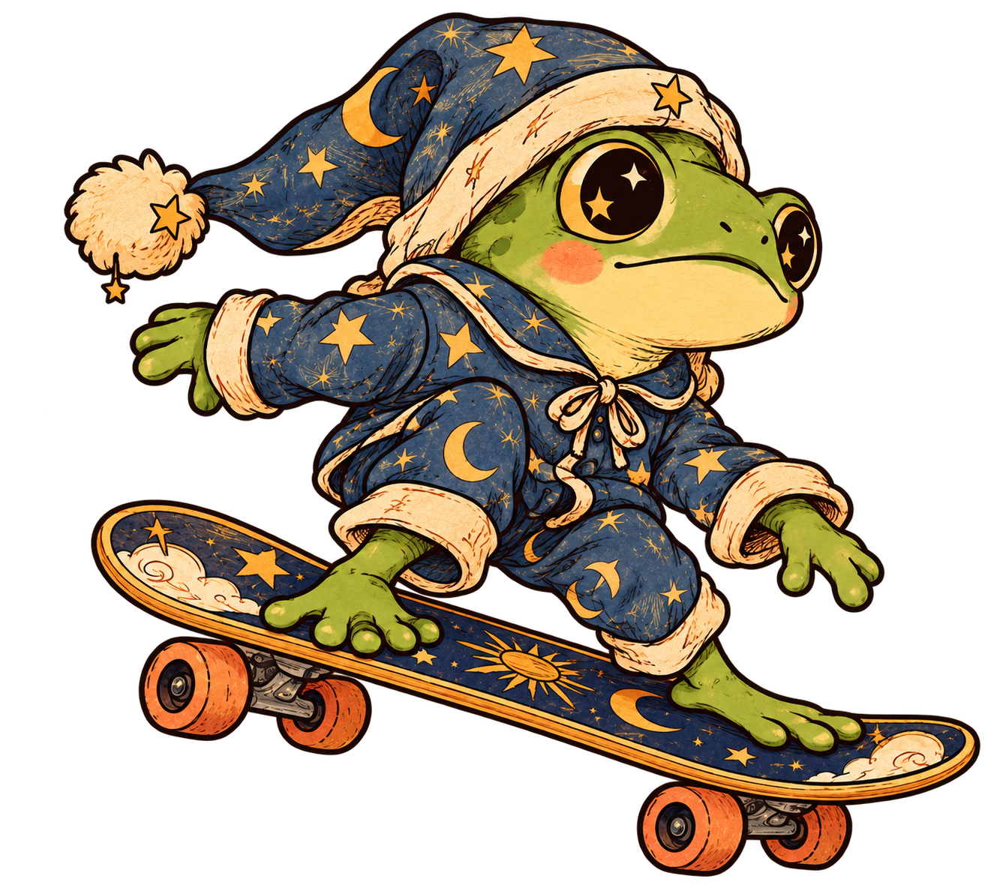
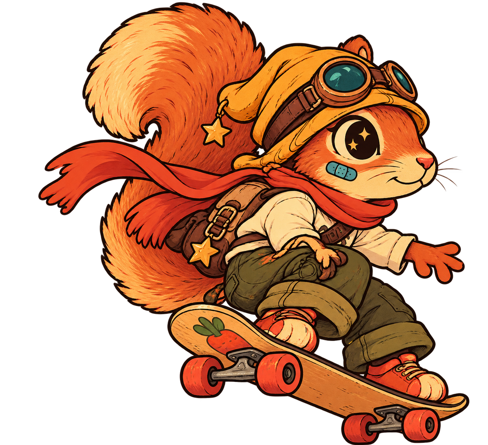
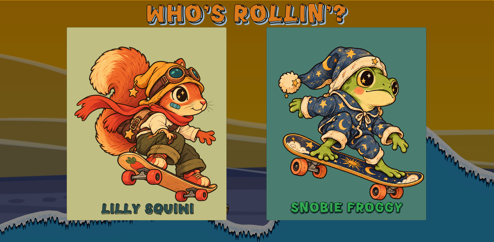
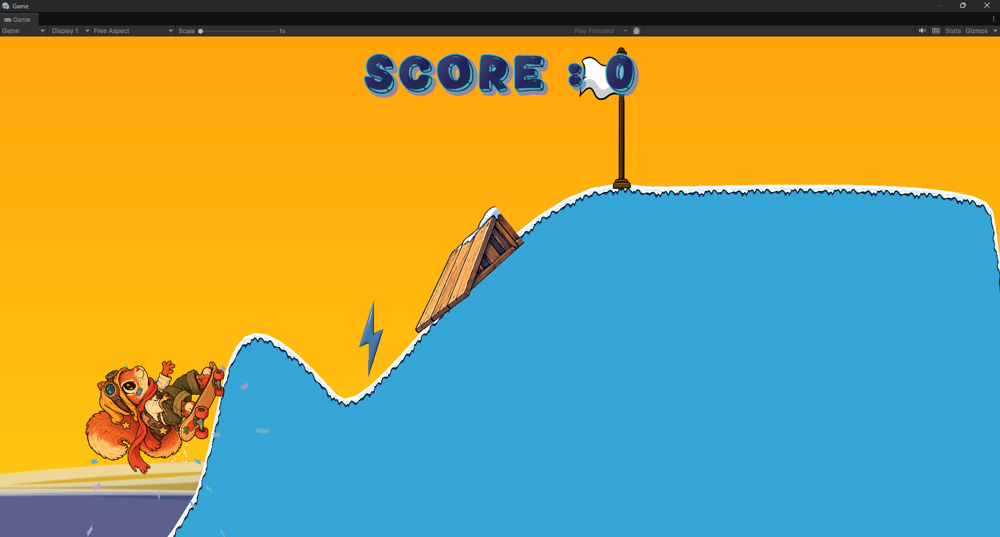
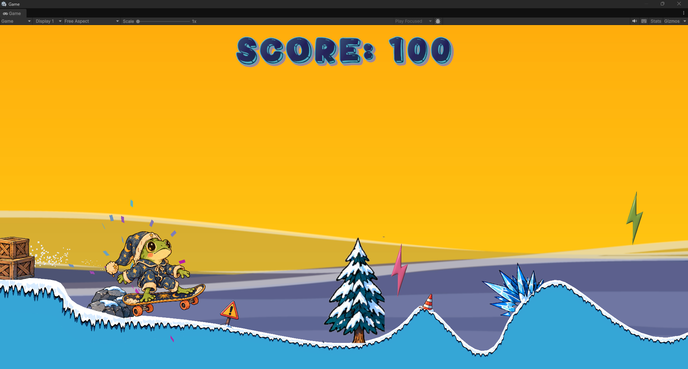

# Flipp Happennnns

<p align="center">
  
  
</p>

<p align="center">
  <strong>A small Unity game project.</strong><br>
  A simple snowboarding game made to practice Unity and C#.
</p>

<p align="center">
  
  
</p>

> **Fliiiip Happens** is a small learning project where you can choose between **Snobie** and **Lily**, ride down snowy slopes, and practice simple game mechanics.

## Meet the riders

Snobie and Lily bring their own style to the slopes. Pick a character, then guide them through ramps, valleys, boosts, and hazards while chasing a higher score.

<p align="center">
  
</p>

*Choose your character before the run begins.*

## About the project

This is one of my Unity projects. I made it to practice some of the basics of Unity and C#, including player movement, physics, character selection, scoring, particles, and scene management.

The goal is to learn by building a small playable game, not to create a large or finished commercial project.

### What I practiced

- 2D player movement and physics
- Character selection between Snobie and Lily
- Basic scoring for flips
- Boosting and momentum
- Snow trails and particle effects
- Finish and crash states

## Screenshots

Here are two screenshots showing the game mechanics:

<p align="center">
  
  
</p>

<p align="center">
  <em>Snobie scores his first 100 points, while Lily approaches the finish line.</em>
</p>

## Video

Here is a short recording of the game:

**[Watch the gameplay recording](Screenshots/gameplay-recording.mp4)**

## Controls

| Action | Keyboard | Gamepad |
| --- | --- | --- |
| Lean / rotate left | `A` or `Left Arrow` | Left stick left |
| Lean / rotate right | `D` or `Right Arrow` | Left stick right |
| Boost downhill | `W` or `Up Arrow` | Left stick up |
| Return to normal speed | Release the boost input | Return the stick to neutral |

### Scoring

| Moment | Result |
| --- | --- |
| Complete one full rotation | `+100` points |
| Touch the finish line | Win particles play, then the scene reloads |
| Hit the floor / crash surface | Controls are disabled, crash particles play, then the scene reloads |

## Built with

- **Unity 6** `6000.3.24f1`
- **C#** gameplay scripts
- **Unity Input System** for keyboard and gamepad input
- **Unity 2D physics** with `Rigidbody2D` and `SurfaceEffector2D`
- **Unity Particle System** for snow trails, crashes, and finishing effects
- **TextMesh Pro** for the score display
- **Universal Render Pipeline 2D** project setup


## Project structure

```text
Assets/
├── Scenes/       The playable Unity scene
├── scripts/      Player movement, character selection, scoring, and effects
├── sprites/      Snobie, Lily, snow terrain, platforms, hazards, and environment art
└── Settings/     Input System actions and 2D scene settings
```

The main gameplay responsibilities are kept in small scripts:

- `playerController.cs` handles rotation, boost speed, flip detection, and score rewards.
- `CharSelectManager.cs` handles choosing the active rider.
- `ScoreManager.cs` updates the on-screen score.
- `SnowTrail.cs` starts and stops the snow effect on ground contact.
- `crashDetector.cs` disables control and reloads after a crash.
- `finishLine.cs` plays the win effect and reloads after reaching the goal.


## Status

This is a small work in progress learning project and a starting point for practicing Unity.
